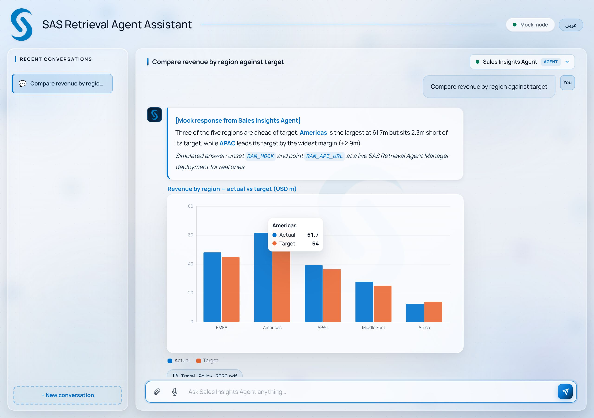

# SAS Retrieval Agent Assistant

A chat UI for **SAS Retrieval Agent Manager (RAM)**. Pick an agent (or a collection) published
on your RAM environment and talk to it: answers, the passages they are grounded in, the agent's
tool calls, charts and token usage all come from RAM's REST API.

It is one small service: a FastAPI backend that signs in to RAM and proxies every call, and a
React frontend that the backend serves. One container, one port, so it runs the same on your
laptop and on Railway.



- [Run it locally](#run-it-locally)
- [Deploy on Railway](#deploy-on-railway)
- [Settings](#settings)
- [Signing in](#signing-in)
- [What the page does](#what-the-page-does)
- [Agents that draw: charts, report snapshots, maps](#agents-that-draw-charts-report-snapshots-maps)
- [Troubleshooting](#troubleshooting)
- [Project layout](#project-layout)

---

## Run it locally

You need **Python 3.10+** and **Node.js 20.19+ or 22.12+**. (Or only Docker: see
[one container](#one-container-instead-docker).)

### 1. Backend (terminal 1)

```bash
cd backend
python -m venv .venv
source .venv/bin/activate        # Windows: .venv\Scripts\activate
pip install -r requirements.txt
cp .env.example .env             # Windows: copy .env.example .env
uvicorn main:app --reload --port 8000
```

### 2. Frontend (terminal 2)

```bash
cd frontend
npm install
npm run dev
```

Open **http://localhost:5173**. The dev server forwards `/api` to the backend on port 8000.

`backend/.env.example` starts in **mock mode** (`RAM_MOCK=true`), so the page works straight
away with made-up agents and no RAM at all; the status pill in the header says *Mock mode*.
Ask for "a chart of revenue by region" or "a route to Dubai Marina" to see the chart and map cards.

### 3. Connect it to your RAM

Edit `backend/.env`:

```bash
RAM_MOCK=false
RAM_API_URL=https://<your-ram-host>/SASRetrievalAgentManager/api/v1
```

Restart the backend (stop it with Ctrl+C and run the `uvicorn` line again; `--reload` watches
code, not `.env`). Reload the page and click **Sign in** in the header. That is the whole setup:
see [Signing in](#signing-in) for what happens next and for the non-interactive options.

If your RAM host uses a self-signed certificate, also set `RAM_VERIFY_SSL=false`.

### One container instead (Docker)

This builds the exact image Railway builds and serves the UI and the API together on port 8000:

```bash
docker build -t ram-ui .
docker run --rm -p 8000:8000 --env-file backend/.env ram-ui
```

Open **http://localhost:8000**.

---

## Deploy on Railway

The repo is ready for Railway: [`railway.toml`](railway.toml) tells it to build the
[`Dockerfile`](Dockerfile), to wait for `/healthz` before sending traffic to a new deploy, and to
restart the service if it crashes. Railway deploys the **`main`** branch.

1. **Create the service.** In Railway: **New Project → Deploy from GitHub repo** and pick this
   repository. (If it is not in the list, use *Configure GitHub App* to give Railway access to it.)
   The first build starts by itself and takes a couple of minutes.

2. **Set the variables.** Open the service → **Variables** and add:

   | Variable | Value |
   |---|---|
   | `RAM_API_URL` | `https://<your-ram-host>/SASRetrievalAgentManager/api/v1` |

   That one variable is enough: people sign in from the page. To try the deploy without a RAM,
   set `RAM_MOCK=true` instead. Every other setting is optional and listed under
   [Settings](#settings). Railway redeploys when variables change.

3. **Give it a public address.** Service → **Settings → Networking → Generate Domain**.

4. **Open the address** and click **Sign in**.

From then on, **every push to `main` redeploys** the service.

### Check that a deploy is healthy

- `https://<your-app>.up.railway.app/healthz` returns `{"status":"ok","build":"<commit>"}`;
  `build` is the commit that is running.
- The deploy log has a line like
  `RAM connection: {'status': 'signin_required', 'mode': 'live', 'ramUrl': 'https://…/api/v1', …}`
  showing the settings the service actually started with.

### Keep people signed in across redeploys (recommended)

A redeploy starts a fresh container, and a fresh container has forgotten who was signed in. Two
things cover that:

- **A volume (reliable).** Attach a volume to the service (right-click the service on the project
  canvas → *Attach volume*) with the mount path `/data`, then add the variable
  `RAM_SESSION_FILE=/data/ram_sessions.json`. Sessions are kept on the volume and survive
  redeploys and restarts.
- **The browser's own copy (automatic, best effort).** With no volume, each browser hands its
  session back to the new container and carries on. This works unless RAM's identity provider
  replaced the refresh token in the minute before the redeploy; in that case that person signs in
  once more.

Run **one replica** (Railway's default): sessions live in the service's memory and its session
file, not in a shared store.

### Optional: the map key

Only if one of your agents draws maps (see [below](#agents-that-draw-charts-report-snapshots-maps)):
add the variable `VITE_TOMTOM_API_KEY` and redeploy. It is used while the image is *built*, so a
redeploy is needed for a change to show.

---

## Settings

Set these in `backend/.env` for a local run, or in the service's **Variables** tab on Railway.
[`backend/.env.example`](backend/.env.example) has the same list with more commentary.

**Connection**

| Variable | Default | What it does |
|---|---|---|
| `RAM_API_URL` | *(none)* | Address of RAM: `https://<host>/SASRetrievalAgentManager/api/v1`. The address you open RAM at in a browser (`…/SASRetrievalAgentManager`) also works; `/api/v1` is added. |
| `RAM_MOCK` | `false` | `true` runs the UI against a built-in mock and ignores everything else. |
| `RAM_VERIFY_SSL` | `true` | `false` to accept a self-signed certificate on the RAM host. |

**Interactive sign-in** (the default; normally nothing to set)

| Variable | Default | What it does |
|---|---|---|
| `RAM_AUTH_FLOW` | auto-detected | `device` (standalone RAM / Keycloak) or `code` (full SAS Viya / SASLogon) to skip the detection. |
| `RAM_CLIENT_ID` | `sas-ram-api` | Keycloak client used by the device flow. |
| `RAM_REALM` | `sas-iot` | Keycloak realm of a standalone RAM. |
| `SAS_AUTH_CLIENT_ID` | `sas.cli` | SASLogon client used by the paste-the-code flow. |
| `SAS_AUTH_CLIENT_SECRET` | *(empty)* | Only if that client has a secret. |

**One shared identity instead** (no Sign in button; see the warning under [Signing in](#signing-in))

| Variable | What it does |
|---|---|
| `RAM_TOKEN` | A bearer token used for every call. Quick demos; it stops working when it expires. |
| `SAS_CLIENT_ID`, `SAS_CLIENT_SECRET` | A registered OAuth client; the backend fetches and renews tokens itself. |
| `SAS_USERNAME`, `SAS_PASSWORD` | With these the client uses the password grant (acts as that user); without, `client_credentials`. |
| `SAS_LOGON_URL` | Token endpoint. Defaults to `https://<host>/SASLogon/oauth/token` (full Viya); for a standalone RAM use `https://<host>/SASRetrievalAgentManager/auth/realms/sas-iot/protocol/openid-connect/token`. |
| `RAM_HIDE_HISTORY` | `true` hides RAM's conversation history, so people sharing the identity do not see each other's conversations. |

**Sessions and queries**

| Variable | Default | What it does |
|---|---|---|
| `RAM_SESSION_FILE` | `backend/data/runtime/ram_sessions.json` | Where signed-in sessions are kept. On Railway point it into a volume. |
| `RAM_BROWSER_RESTORE` | `true` | `false` stops the browser keeping a copy of its refresh token (tokens then stay on the server only; a redeploy without a volume signs people out). |
| `RAM_KEEPALIVE_SECONDS` | `60` | How often sessions are checked and renewed before they expire. |
| `RAM_QUERY_TIMEOUT` | `600` | Seconds to wait for an agent's answer. |
| `RAM_QUERY_POLL_INTERVAL` | `2` | Seconds between checks for the answer. |
| `CORS_ORIGINS` | *(none)* | Only if you host the frontend on a different origin: the allowed origins, comma-separated. |
| `PORT` | `8000` | Port to listen on. Railway sets it; do not set it yourself there. |

**Frontend build** (optional, map card only; build-time, see [`frontend/.env.example`](frontend/.env.example))

| Variable | What it does |
|---|---|
| `VITE_TOMTOM_API_KEY` | TomTom key the browser uses for map and traffic tiles. It is visible in the page: restrict it to your domain. |
| `VITE_MAP_STYLE_URL` | A custom vector map style. |
| `VITE_MAP_RASTER` | `true` forces the flat raster basemap. |

---

## Signing in

With only `RAM_API_URL` set, the header shows **Sign in** and each person signs in to RAM as
themselves. The backend works out which kind of RAM it is talking to:

- **Standalone RAM (Keycloak):** the page shows a short code. Open the verification page, log
  in with your RAM user, enter the code. The page connects by itself a few seconds later.
- **Full SAS Viya (SASLogon):** a SAS log-in page opens in a new tab (single sign-on included)
  and shows an authorization code. Paste it into the page.

After that:

- **Each browser has its own RAM identity.** Tokens are kept on the server under an HttpOnly
  cookie; two people on the same deployment never see each other's agents or conversations.
- **You stay signed in.** Sessions are renewed in the background before they expire, are saved
  to `RAM_SESSION_FILE` so a restart keeps them, and can be handed back by the browser after a
  redeploy ([details](#keep-people-signed-in-across-redeploys-recommended)).
- **Sign out** in the header ends the session: it is revoked at RAM's identity provider where
  that is possible and forgotten by the server and the browser.

Good to know:

- To let a redeploy pick a session back up, the browser keeps a copy of its **refresh token**
  (never the access token) in its local storage. If you would rather keep every token on the
  server, set `RAM_BROWSER_RESTORE=false` and use a volume.
- With `RAM_TOKEN` or `SAS_CLIENT_ID` there is **no sign-in at all: anyone who can open the
  address uses RAM as that identity.** Fine on your own machine or a private network; on a public
  Railway address prefer the interactive sign-in.

---

## What the page does

- **Agent dropdown:** every agent published on the RAM environment, plus its collections for
  direct retrieval questions.
- **Conversations with memory:** each chat is a RAM *query session*, so the agent keeps the
  context from turn to turn.
- **History:** past conversations are loaded from RAM, listed under *Recent conversations* for
  the selected agent, and rebuilt in the order they happened when opened, charts included.
- **Grounding you can inspect:** source chips open the retrieved passage; the tool-call trace
  and token usage sit under each answer; the details icon opens the full trace (tool calls with
  inputs and outputs, LLM calls, retrieval calls).
- **Live activity:** while an agent works, the page lists the tool, retrieval and LLM calls
  recorded so far. Questions are submitted asynchronously and polled, so a slow agent is never
  cut off by a gateway timeout.
- **Attachments:** attach a PDF, DOCX or text file and its text is sent with the question
  (up to 20,000 characters; scanned PDFs and images are not readable).
- **Voice:** dictate a question in browsers that support speech recognition (Chrome, Edge, Safari).
- **English and Arabic:** the language button switches the interface, right-to-left included.
  Answers follow the language of the question.
- **Rename and delete conversations:** these apply in your browser only, because RAM's v1 API
  cannot rename or delete a query session.

---

## Agents that draw: charts, report snapshots, maps

RAM returns text and tool calls, not pictures. The page looks at the **output of the agent's
tool calls** and draws a card when it finds one of these JSON shapes (as an object, or as a JSON
string in a text block, which is how MCP tools usually return it):

**Chart** (for example from a `render_chart` MCP tool):

```json
{
  "kind": "chart",
  "type": "bar",
  "title": "Revenue by region",
  "data": [{"region": "EMEA", "actual": 48.2, "target": 45.0}],
  "xKey": "region",
  "yKeys": [{"key": "actual", "label": "Actual"}, {"key": "target", "label": "Target"}],
  "stacked": false
}
```

`type` is `bar`, `line`, `area`, `pie` or `scatter`; `yKeys` entries may be plain column names.

**Report snapshot** (for example a SAS Visual Analytics report image):

```json
{
  "kind": "report_image",
  "imageUrl": "https://…/report.png",
  "reportName": "Sales overview",
  "sectionName": "Summary",
  "viewerUrl": "https://…/SASVisualAnalytics/…"
}
```

`imageUrl` must be an address the user's browser can load.

**Map** (`"kind": "tomtom.map"` from the TomTom MCP's `tomtom-render-map` tool): routes, markers,
traffic incidents and areas on an interactive map. Setup is in
[`docs/tomtom-agent.md`](docs/tomtom-agent.md); it needs `VITE_TOMTOM_API_KEY`.

---

## Troubleshooting

| What you see | What to do |
|---|---|
| Pill says **Not configured** | `RAM_API_URL` is not set (and `RAM_MOCK` is not `true`). Set one and restart / redeploy. |
| Pill says **Backend offline** | Local: the backend is not running on port 8000. Railway: look at the deploy log. |
| Dropdown says **Service unreachable**, error mentions *Could not reach SAS RAM* | The backend cannot open a connection to the RAM host. Check the address; `RAM_VERIFY_SSL=false` for a self-signed certificate. On Railway the RAM host must be reachable from the internet: a RAM behind a VPN is not. |
| **Sign in** fails with *Device authorization failed* | The realm or client differs from the defaults: set `RAM_REALM` / `RAM_CLIENT_ID`. If this RAM is part of a full SAS Viya, set `RAM_AUTH_FLOW=code`. |
| Dropdown error says **Not Found** (404) | `RAM_API_URL` points at something that is not RAM's API. It should end in `/SASRetrievalAgentManager/api/v1`. |
| Everyone has to sign in again after a deploy | Add a volume and `RAM_SESSION_FILE` ([how](#keep-people-signed-in-across-redeploys-recommended)). |
| Railway shows **Application failed to respond** | The deploy log says `Uvicorn running on http://0.0.0.0:<port>`. In Settings → Networking, the domain's port must be that port. Do not set `PORT` yourself. |
| Map card says **Set VITE_TOMTOM_API_KEY** | Set the key and rebuild (locally: `frontend/.env.local`; Docker: `--build-arg`; Railway: add the variable and redeploy). |
| No microphone button | The browser has no speech recognition (Firefox). |
| A deleted conversation is back in another browser | Deleting hides it in the browser where you deleted it; RAM's API cannot delete a session. |

---

## Project layout

```
Dockerfile              builds the frontend, then the backend image that serves both
railway.toml            Railway: build the Dockerfile, health check on /healthz
backend/
  main.py               FastAPI app: /api routes, /healthz, serves the built frontend
  routers/ram.py        the /api routes (sign-in, agents, sessions, queries, attachments)
  services/ram.py       RAM client: sign-in flows, per-browser sessions, keep-alive, mock
  .env.example          every setting, documented
frontend/
  src/pages/ChatPage.jsx        the chat
  src/components/               header, sign-in, answer card, chart / report / map cards, trace
  src/context/                  conversations, language
  src/services/                 API client, chart / report / map spec extraction
  src/i18n.js                   English and Arabic strings
docs/tomtom-agent.md    setting up the map agent
```

The browser only ever talks to this backend (`/api/*`); the backend talks to RAM
(`/SASRetrievalAgentManager/api/v1`) with the signed-in person's token.

### What RAM's v1 API does not offer

- **Streaming:** answers arrive whole, so the page shows live activity instead of text
  appearing word by word.
- **Renaming or deleting query sessions:** done in the browser only.
- **Creating or configuring agents, collections or models:** do that in RAM itself.
- **Feedback on an answer** (thumbs up / down): there is no endpoint for it.
